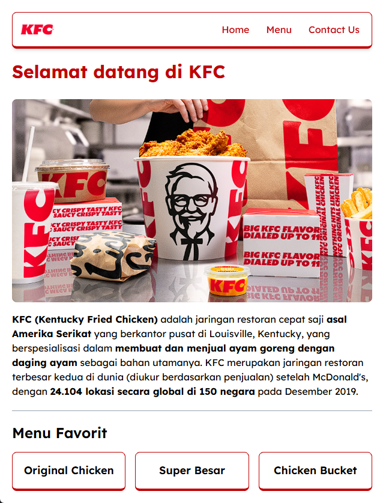
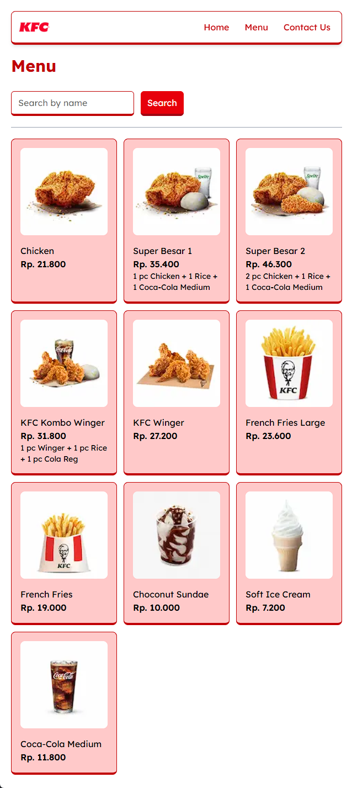
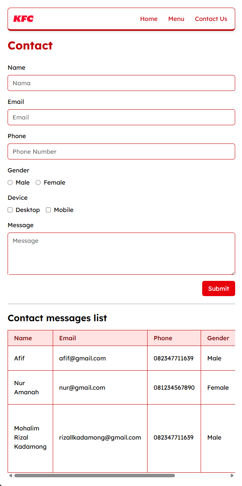

## Website KFC

Website ini berisikan informasi mengenai KFC, menu favorit, menu makanan KFC dengan pencarian, dan formulir kontak yang bisa diisi.

### Tampilan Halaman Home
<p align="center">

</p>

### Tampilan Halaman Menu
<p align="center">

</p>

### Tampilan Halaman Contact Us
<p align="center">

</p>

## Alur Penggunaan Website
1. Kunjungi halaman Home untuk melihat informasi tentang KFC dan Menu Favorit.
2. Kunjungi halaman Menu untuk melihat daftar makanan di KFC. Bisa menggunakan fitur pencarian untuk lebih cepat.
3. Kunjungi halaman Contact Us untuk mengisi formulir yang bisa diisi lalu akan dikirimkan ke KFC.

## Cara Menjalankan Project
1. Clone repository ini
2. Install dependencies :
   ```bash
   npm install
   ```
3. Jalankan aplikasi :
   ```bash
   npm run dev
   ```